<a id="top"></a>

<div align="center">


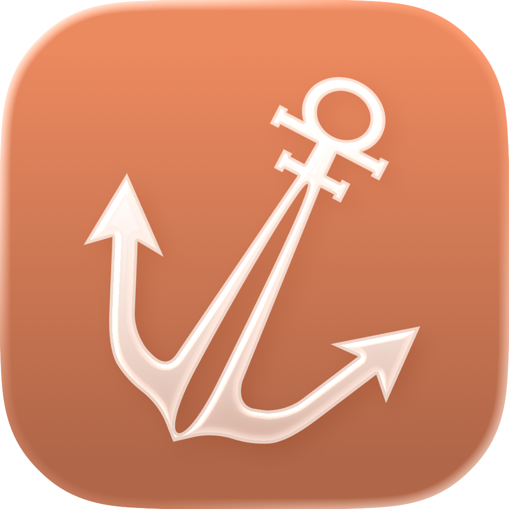
<br/>
<a href="#what-sailors-does">
  
</a>

<p>
  <b>Sailors makes you better at public speaking.</b> It is an open-source coach for iPhone
  that turns a rough idea into a speaker-ready script, drills you on it a few minutes a day,
  and reads it back to you when you are standing in front of the room.
</p>

<p>
  
  
  
  
  <br />
  
  
  <a href="CONTRIBUTING.md"></a>
  <a href="https://github.com/divyanshu-patil/sailors/commits/main"></a>
</p>

<p>
  <a href="#what-sailors-does"><kbd>&nbsp;Features&nbsp;</kbd></a>&nbsp;
  <a href="#the-mvp"><kbd>&nbsp;The MVP&nbsp;</kbd></a>&nbsp;
  <a href="#plans"><kbd>&nbsp;Plans&nbsp;</kbd></a>&nbsp;
  <a href="#under-the-hood"><kbd>&nbsp;Stack&nbsp;</kbd></a>&nbsp;
  <a href="#sponsors--partners"><kbd>&nbsp;Sponsors&nbsp;</kbd></a>&nbsp;
  <a href="#the-team"><kbd>&nbsp;Team&nbsp;</kbd></a>&nbsp;
  <a href="CONTRIBUTING.md"><kbd>&nbsp;Contributing&nbsp;</kbd></a>
</p>

</div>

<br />

## Why we built Sailors

Almost every career has a moment that turns on five minutes of talking. A pitch. A demo. A
standup that suddenly matters. A wedding toast. Most people prepare for those five minutes
by writing something the night before, reading it twice, and hoping.

The tools that exist each solve a third of the problem:

<table>
  <tr>
    <td align="center" width="33%">🤖<br /><b>A chatbot</b><br /><sub>writes you a script, then leaves you alone with it</sub></td>
    <td align="center" width="33%">📜<br /><b>A teleprompter</b><br /><sub>scrolls text at you, but doesn't care whether you've ever said the words out loud</sub></td>
    <td align="center" width="33%">🎓<br /><b>A course</b><br /><sub>teaches theory on a Tuesday you can't recall on the Friday you need it</sub></td>
  </tr>
</table>

> [!IMPORTANT]
> **Nobody owns the loop.** Writing, rehearsing and delivering are the same job, and they
> belong in the same place: the phone that is already in your pocket when you walk up to
> speak.

That is Sailors. One app that takes you from "I have to talk about this on Thursday" to
standing up and doing it, with the reps in between that actually make the difference.

And the goal is bigger than Thursday. Every script, every daily rep and every run on the
teleprompter is practice at the same skill, so the next talk is easier than this one.
**Sailors exists to make people better public speakers**, not just to get them through one
speech.

<div align="center">
<table>
  <tr>
    <td align="center" width="25%"><h3>✍️</h3><b>Generate</b><br /><sub>a presentation script from one sentence</sub></td>
    <td align="center">→</td>
    <td align="center" width="25%"><h3>🃏</h3><b>Practise</b><br /><sub>on colour-coded cards you can feel</sub></td>
    <td align="center">→</td>
    <td align="center" width="25%"><h3>🔁</h3><b>Learn the patterns</b><br /><sub>a 2-minute framework talk a day</sub></td>
    <td align="center">→</td>
    <td align="center" width="25%"><h3>🎤</h3><b>Deliver</b><br /><sub>from the teleprompter</sub></td>
  </tr>
</table>
</div>

<br />

## Screenshots

<div align="center">
<table>
  <tr>
    <td align="center" width="33%">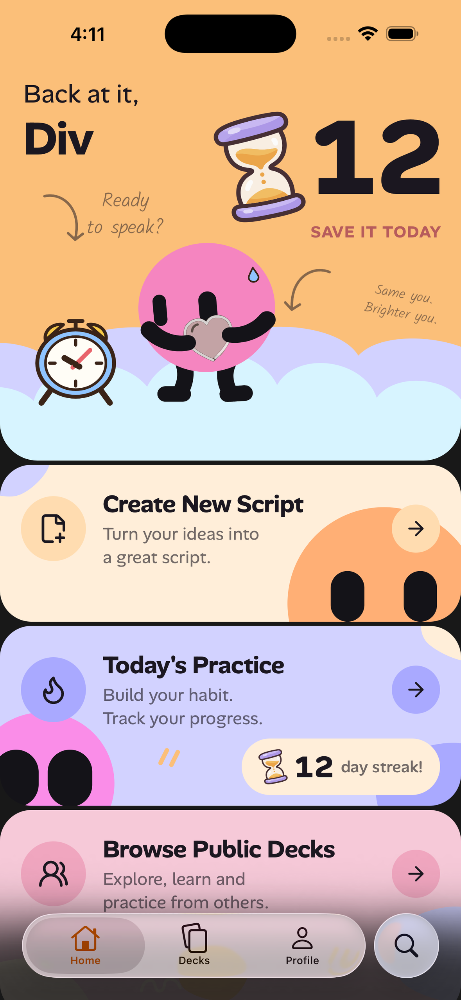</td>
    <td align="center" width="33%">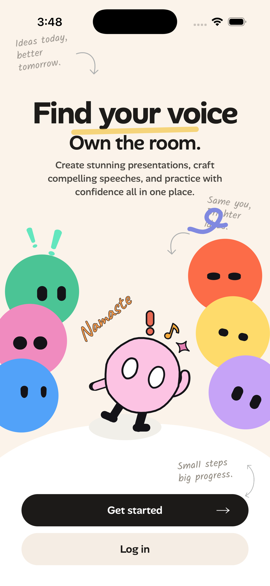</td>
    <td align="center" width="33%">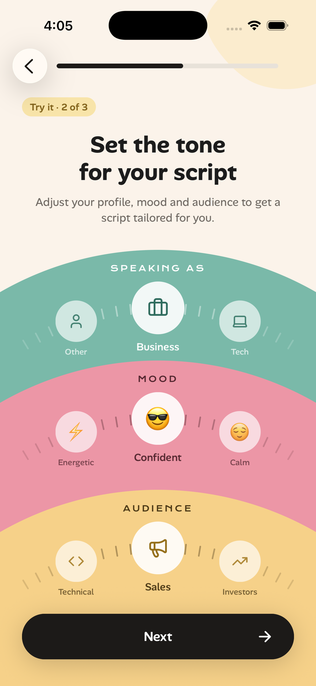</td>
  </tr>
  <tr>
    <td align="center"><sub><b>Home</b></sub></td>
    <td align="center"><sub><b>Onboarding</b></sub></td>
    <td align="center"><sub><b>Speaking as, mood, audience</b></sub></td>
  </tr>
</table>
</div>

<div align="center">
<table>
  <tr>
    <td align="center" width="33%">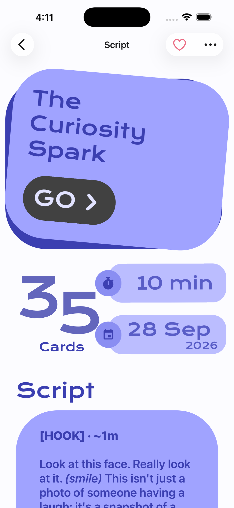</td>
    <td align="center" width="33%">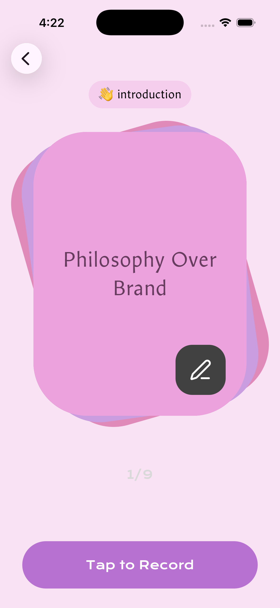</td>
    <td align="center" width="33%">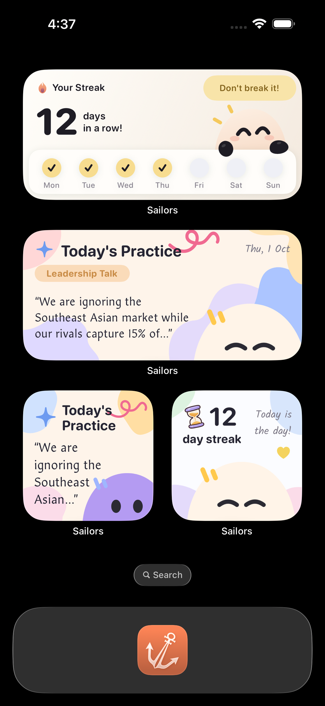</td>
  </tr>
  <tr>
    <td align="center"><sub><b>Script detail</b></sub></td>
    <td align="center"><sub><b>Script practice</b></sub></td>
    <td align="center"><sub><b>Widgets</b></sub></td>
  </tr>
</table>
</div>

**Streak and restore**

<div align="center">
<table>
  <tr>
    <td align="center" width="20%">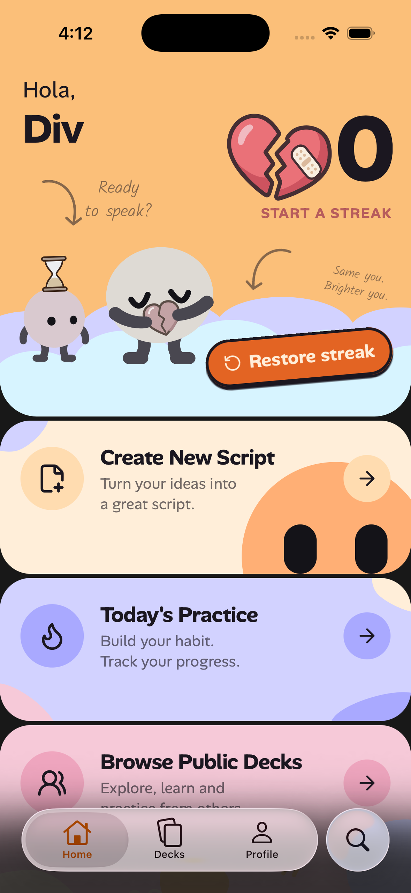</td>
    <td align="center" width="20%">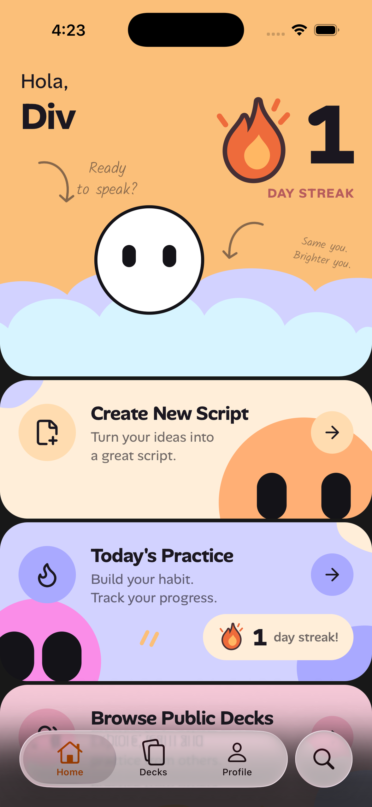</td>
    <td align="center" width="20%"></td>
    <td align="center" width="20%">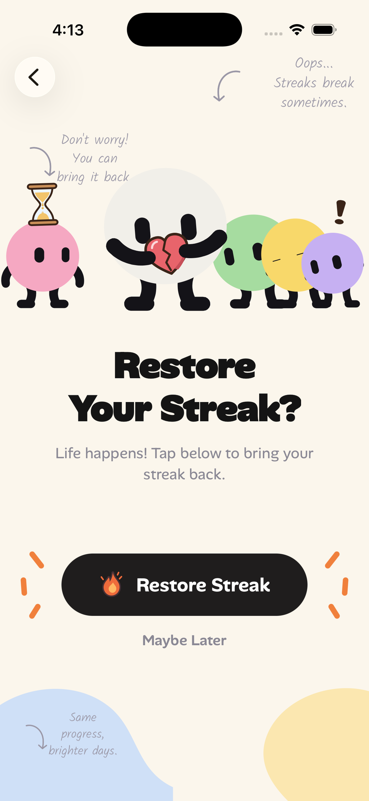</td>
    <td align="center" width="20%">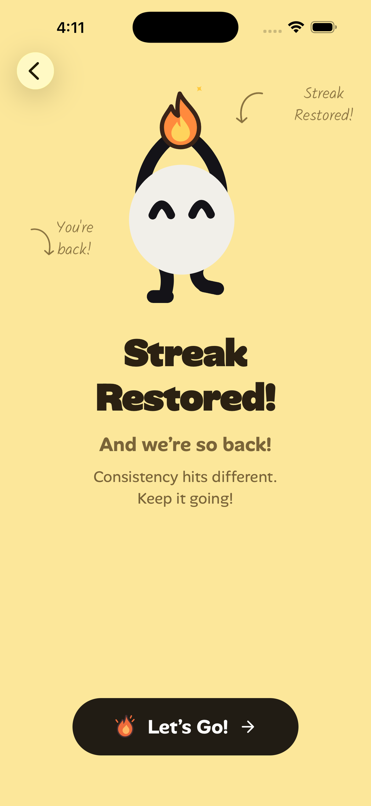</td>
  </tr>
  <tr>
    <td align="center"><sub><b>Streak broken</b></sub></td>
    <td align="center"><sub><b>1-day streak</b></sub></td>
    <td align="center"><sub><b>12-day streak</b></sub></td>
    <td align="center"><sub><b>Restore offer</b></sub></td>
    <td align="center"><sub><b>Restored</b></sub></td>
  </tr>
</table>
</div>

<br />

## What Sailors does

The heart of Sailors is two steps: **generate a presentation script, then practise it on
cards that are colour-coded and haptic, so it's easy to remember.** Around that core,
**daily practice** teaches the patterns behind good talks in two minutes a day, so you get
better at speaking itself and not just at one speech.

### ✍️ 1. Generate a presentation script

Describe the talk in a sentence. Attach the brief, the PDF, the deck you were handed.
Set how long you have, who is listening, and the mood you want to strike.

Sailors writes the whole thing:

- **A structured script**, not a wall of text: beats marked `[HOOK]`, `[CORE MESSAGE]`
  and so on, with the phrases that carry weight stressed, and pauses written in where a
  room needs a second to catch up.
- **A deck of practice cards** generated alongside it, one idea per card. That deck is
  step two.
- **Written for you specifically.** You tell Sailors your profession and how much speaking
  experience you have, once. Every script after that is pitched at that person: the same
  brief produces a different talk for a first-time founder than for a staff engineer.

### 🃏 2. Practise it on colour-coded, haptic cards

Reading a script over and over is how most people rehearse, and it's why the words vanish
the moment they stand up. Sailors breaks the script into cards, **one idea per card**, each
with its keywords and a delivery style, and swiping through them is the rehearsal.

Every card also carries **how hard it is meant to land**, and you get that two ways at once:

<table>
  <tr>
    <td width="50%" valign="top">
      <h4>🎨 You see it</h4>
      The card's colour runs from calm to peak. The harder the line should hit, the more
      vivid the card, so the shape of the talk is visible at a glance.
      <br /><br />
      
      
      
      
      
    </td>
    <td width="50%" valign="top">
      <h4>📳 You feel it</h4>
      Five impact tiers, each with its own haptic, played as the card arrives. A quiet
      line is a soft tap; the emotional core or the call to action hits hard. You learn
      where the talk peaks through your hand, not just your eyes.
    </td>
  </tr>
</table>

Colour and touch give your memory two more hooks than the words alone, so you remember
the rhythm of the talk and not just its sentences. And it stays honest: a deck of quiet
lines looks quiet and feels quiet, with no fake "climax" card forced into every deck.

When you're ready, **record yourself** against the deck and play the take back.

<details>
<summary><sub>How the colours are chosen</sub></summary>
<br />

Colours are generated in OKLCH, a colour space where equal steps look equally different,
so a stronger line is always a visibly more vivid card. Following colour-emotion research
(saturation drives arousal, brightness drives pleasantness), impact is carried mostly by
chroma. Lightness only eases down a little, so every card stays a bright, pleasant pastel.
The hue travels from mint through sky and the brand lavender to pink and coral, taking the
long way round the wheel so it never passes the dull yellow-sand that disappears into the
cream page.

</details>

---

**Around the core:** the pieces that turn one rehearsed talk into a speaking habit.

### 🔁 3. Daily practice: learn the patterns behind good talks

A script gets you through one talk. But most speaking isn't a prepared talk. It's a
question in a meeting, an answer in an interview, "so, what do you do?". There's no script
for those. What helps is a **pattern** you can pour any content into, and that's what daily
practice trains.

Every day is one **two-minute talk built on a named public-speaking framework**:

<table>
  <tr>
    <td align="center" width="33%" valign="top">
      <h3>🧭</h3><b>1. See the shape</b><br />
      <sub>The framework's steps, a one-line hint for each, and the situations it's for</sub>
    </td>
    <td align="center" width="33%" valign="top">
      <h3>🎤</h3><b>2. Say it out loud</b><br />
      <sub>A short talk applying it to a real topic, read line by line on a teleprompter reel</sub>
    </td>
    <td align="center" width="33%" valign="top">
      <h3>💡</h3><b>3. Take one tip</b><br />
      <sub>A delivery cue for today's framework, and your streak ticks up</sub>
    </td>
  </tr>
</table>

> **PREP** &nbsp;·&nbsp; Point → Reason → Example → Point
>
> *Answer first, then justify it. The fastest way to sound decisive when someone puts you on
> the spot.*

#### Why it works

- **Patterns, not pep talks.** "Be more confident" can't be practised. "Answer first, then
  one reason, one example, and the point again" can, and after a few reps it's how you
  answer without thinking.
- **One shape, many rooms.** Each framework comes back in a different situation from the
  ones it suits: PREP in an interview one time, a conference Q&A the next. You learn *when*
  to reach for a pattern, not just what it is.
- **Spaced, not crammed.** 22 frameworks rotate, so each one returns every 22 days instead
  of being drilled once and forgotten.
- **Small enough to do every day.** Two minutes fits a coffee queue, and the streak brings
  you back tomorrow.
- **It feeds the core.** Once you know the shapes, you can see them in the scripts Sailors
  writes, and when a Q&A pulls you off-script, you have a structure ready.

<details>
<summary><b>All 22 frameworks in the rotation</b></summary>
<br />

| Framework | The pattern | Reach for it in |
| :-- | :-- | :-- |
| **PREP** | Point → Reason → Example → Point | Interviews, Business, Conferences |
| **STAR** | Situation → Task → Action → Result | Interviews, Business |
| **So What / Now What** | What → So What → Now What | Business, Technical explanations, Conferences |
| **SCQA** | Situation → Complication → Question → Answer | Business, Technical explanations, Academic |
| **PAS** | Problem → Agitate → Solution | Sales, Product demos, Business |
| **4Ps** | Problem → Pain → Proof → Promise | Sales, Business |
| **AIDA** | Attention → Interest → Desire → Action | Product demos, Sales, Conferences |
| **Golden Circle** | Why → How → What | Leadership talks, Conferences, Social |
| **Monroe's Sequence** | Attention → Need → Satisfaction → Visualization → Action | Conferences, Leadership talks, Sales |
| **ABT** | And → But → Therefore | Business, Technical explanations, Networking |
| **Story Spine** | Once upon a time → Every day → Until one day → Because of that → Until finally | Product demos, Social, Conferences |
| **Before-After-Bridge** | Before → After → Bridge | Product demos, Social, Sales |
| **Claim-Evidence-Meaning** | Claim → Evidence → Meaning | Technical explanations, Academic, Business |
| **Rule of Three** | First → Second → Third | Teaching, Technical explanations, Conferences |
| **Contrast** | What most people think → But the reality → So what we do instead | Conferences, Social, Leadership talks |
| **Teach-Demo-Explain** | Teach → Demonstrate → Explain | Product demos, Teaching, Technical explanations |
| **Pyramid Principle** | Conclusion → Supporting reasons → Detail beneath each reason | Business, Academic, Technical explanations |
| **Feynman** | Say it in plain words → Use an everyday analogy → Strip every term a non-expert wouldn't know | Technical explanations, Teaching, Academic |
| **Elevator Pitch** | For [who] → [product] is a [category] → that [benefit] → unlike [alternative] | Networking, Sales, Interviews |
| **Hook-Story-Offer** | Hook → Story → Offer | Social, Sales, Networking |
| **7 Ps** | Purpose → Preparation → Plan → Practice → Presentation → Participation → Performance | Preparing any talk, Teaching |
| **10 / 30 / 2-Minute** | The 10-second version → The 30-second version → The 2-minute version | Networking, Interviews, Technical explanations |

</details>

Keep the chain going and you get a **streak**: on the home screen, on an iOS
**home-screen widget**, and in a reminder at the time you choose. Miss a day and life
happens, so there is one **streak restore** a month, offered on the day the streak breaks
and not after, because a streak you can undo at any time was never a streak. The app warns
you before it expires, on time, even if it is closed.

### 🎤 4. Teleprompter

The moment itself. Your script, full screen, scrolling at a pace you control.

| Gesture | What it does |
| :-- | :-- |
| <kbd>0.25×</kbd> … <kbd>3×</kbd> | Autoscroll speed, changed from the toolbar mid-sentence, with the current speed always shown on the button |
| <kbd>Hold</kbd> the middle | Pause: the "wait, they asked a question" gesture |
| <kbd>Hold</kbd> either edge | Run at double speed while your thumb is down, the same hold language as the apps everyone already uses |
| <kbd>Drag</kbd> back | Re-read a line; the scroll carries on from where you left it rather than racing to catch up |
| ⏱️ Stopwatch | On the button, so you know whether you are running long while you can still do something about it |

### 🌍 5. Public decks

Speaking is learned by watching other people do it. Publish a deck and it appears in
**Discover**, where anyone can read the script, practise the cards, and save it. Browse
what other people are working on, take the structure that works, and make it yours.

<div align="right"><a href="#top"><sub>↑ back to top</sub></a></div>

## Also in the app

<table>
  <tr>
    <td width="50%" valign="top">
      <h4>🎙️ Record your takes</h4>
      Record yourself against a deck and play it back. One take per deck, kept on the
      device and synced for you alone.
    </td>
    <td width="50%" valign="top">
      <h4>✈️ Works without signal</h4>
      Scripts, decks, cards and streaks are cached on the device and render before the
      network is asked anything. Backstage wifi is a myth; the app assumes so.
    </td>
  </tr>
  <tr>
    <td valign="top">
      <h4>🧩 Native, not a web page</h4>
      Built with SwiftUI components, real native navigation, and system materials. It
      behaves the way an iPhone app is supposed to.
    </td>
    <td valign="top">
      <h4>🔔 Reminders that know the deadline</h4>
      The streak alarm is scheduled against the exact minute your streak dies,
      rescheduled whenever you practise or open the app, and cancelled the moment you
      are safe.
    </td>
  </tr>
  <tr>
    <td valign="top">
      <h4>🎨 A mascot with feelings</h4>
      The character reacts to what you are doing: celebrating, waiting, sulking when a
      streak breaks.
    </td>
    <td valign="top">
      <h4>📳 Haptics you can feel the shape of</h4>
      Every detent, commit and celebration has its own texture, fired on the UI thread so
      it lands with the frame rather than a beat behind it. One switch in Settings turns
      the lot off.
    </td>
  </tr>
</table>

<br />

## The MVP

Version 1 is a complete loop, not a demo. The core is **generate a script, then practise it
on colour-coded, haptic cards**; everything else builds on it. Everything marked shipped is
built and running.

| Area | Status |
| :-- | :--: |
| **Core:** AI presentation-script generation, with attachments, duration, audience and mood |  |
| **Core:** practice card decks per script, colour-coded and haptic by impact |  |
| **Core:** record yourself against a deck and play it back |  |
| Daily practice: two-minute talks across 22 public-speaking frameworks, with streaks, restore and reminders |  |
| iOS home-screen widget: per-state art, copy and tap target |  |
| Teleprompter with speed control and hold gestures |  |
| Discover: publish, browse, save, practise public decks |  |
| Subscriptions, paywall and plan management |  |
| Offline-first cache across the app |  |
| Delivery feedback: pace, filler words, clarity from your recording |  |
| Android |  |

> [!NOTE]
> **Sailors is iOS only.** It is built against iOS 17 and up, and leans on native
> components, widgets and system materials that have no Android equivalent today. An
> Android version is on the roadmap, not in this release.

<div align="right"><a href="#top"><sub>↑ back to top</sub></a></div>

## Plans

Sailors is a paid app. There is no free tier and no credits to ration: one subscription
opens the whole product, and nothing inside it is metered.

<table>
  <thead>
    <tr>
      <th align="left"></th>
      <th align="center">Without a plan</th>
      <th align="center">🌊 <b>Wave</b><br /><sub>billed monthly</sub></th>
      <th align="center">🧭 <b>Voyager</b><br /><sub>billed annually</sub></th>
    </tr>
  </thead>
  <tbody>
    <tr><td>Browse public decks in Discover</td><td align="center">✅</td><td align="center">✅</td><td align="center">✅</td></tr>
    <tr><td>Create scripts, decks and practice cards</td><td align="center">—</td><td align="center">Unlimited</td><td align="center">Unlimited</td></tr>
    <tr><td>Rewrite a script, regenerate its cards</td><td align="center">—</td><td align="center">Unlimited</td><td align="center">Unlimited</td></tr>
    <tr><td>Daily practice, streaks and the home-screen widget</td><td align="center">—</td><td align="center">Unlimited</td><td align="center">Unlimited</td></tr>
    <tr><td>Teleprompter</td><td align="center">—</td><td align="center">Unlimited</td><td align="center">Unlimited</td></tr>
    <tr><td>Record and play back your takes</td><td align="center">—</td><td align="center">Unlimited</td><td align="center">Unlimited</td></tr>
    <tr><td>Publish your own decks</td><td align="center">—</td><td align="center">Unlimited</td><td align="center">Unlimited</td></tr>
  </tbody>
</table>

Same product either way; the only difference is how often you pay for it.

<details>
<summary><b>Why there is no free tier</b></summary>
<br />

Every script, every deck of cards and every rewrite is real model work, paid for on the
first tap. A free tier would mean the people who show up to practise subsidising the people
who never intended to speak. So the trade is honest in the other direction: nothing is
rationed once you are in. Write ten drafts of the same talk if that is what it takes.

**Public decks are the open door.** Discover needs no plan: download the app, sign in, and
read everything the community has published. The library is genuinely free, rather than the
tool being crippled until you pay.

</details>

Billing runs through [RevenueCat](https://www.revenuecat.com/), so plans, prices and the
paywall are configured without shipping an app update.

<br />

## Under the hood

The short version. The full setup lives in **[CONTRIBUTING.md](CONTRIBUTING.md)**.

<table>
  <tr>
    <td width="20%"><b>iPhone app</b></td>
    <td>&nbsp;Expo SDK 57&nbsp;&nbsp;&nbsp;&nbsp;&nbsp;React Native 0.86&nbsp;&nbsp;&nbsp;&nbsp;&nbsp;TypeScript&nbsp;&nbsp;&nbsp;&nbsp;&nbsp;Expo Router&nbsp;&nbsp;&nbsp;&nbsp;&nbsp;Reanimated&nbsp;&nbsp;&nbsp;&nbsp;&nbsp;Pulsar haptics&nbsp;&nbsp;&nbsp;&nbsp;&nbsp;Skia</td>
  </tr>
  <tr>
    <td><b>Native layer</b></td>
    <td>&nbsp;SwiftUI via <code>@expo/ui</code>&nbsp;&nbsp;&nbsp;&nbsp;&nbsp;WidgetKit&nbsp;&nbsp;&nbsp;&nbsp;&nbsp;system materials</td>
  </tr>
  <tr>
    <td><b>API</b></td>
    <td>&nbsp;FastAPI&nbsp;&nbsp;&nbsp;&nbsp;&nbsp;Python 3.14&nbsp;&nbsp;&nbsp;&nbsp;&nbsp;SQLAlchemy&nbsp;&nbsp;&nbsp;&nbsp;&nbsp;Alembic</td>
  </tr>
  <tr>
    <td><b>Background work</b></td>
    <td>&nbsp;Celery&nbsp;&nbsp;&nbsp;&nbsp;&nbsp;Redis</td>
  </tr>
  <tr>
    <td><b>Data</b></td>
    <td>&nbsp;Postgres&nbsp;&nbsp;&nbsp;&nbsp;&nbsp;Supabase&nbsp;&nbsp;&nbsp;&nbsp;&nbsp;SQLite on device</td>
  </tr>
  <tr>
    <td><b>Object storage</b></td>
    <td>&nbsp;AWS S3&nbsp;&nbsp;&nbsp;&nbsp;recordings, briefs and attachments</td>
  </tr>
  <tr>
    <td><b>Identity &amp; billing</b></td>
    <td>&nbsp;Clerk&nbsp;&nbsp;&nbsp;&nbsp;&nbsp;RevenueCat</td>
  </tr>
  <tr>
    <td><b>Models</b></td>
    <td>&nbsp;<b>OpenRouter</b> first, then&nbsp;&nbsp;&nbsp;&nbsp;&nbsp;Ollama&nbsp;&nbsp;&nbsp;&nbsp;&nbsp;Anthropic&nbsp;&nbsp;&nbsp;&nbsp;&nbsp;OpenAI&nbsp;&nbsp;&nbsp;&nbsp;&nbsp;Gemini&nbsp;&nbsp;&nbsp;&nbsp;&nbsp;Groq</td>
  </tr>
  <tr>
    <td><b>Monitoring</b></td>
    <td>&nbsp;Sentry</td>
  </tr>
</table>

> [!TIP]
> **Script generation is tested on [Ollama](https://ollama.com/).** It is the default
> provider (`AI_PROVIDER=ollama`), so the whole pipeline runs against a model on your own
> machine: brief in, structured script and practice cards out, no API key and no bill. The
> hosted providers are the same code path behind a different adapter: swap `AI_PROVIDER`
> and the pipeline does not notice.

<details open>
<summary><b>Three things worth knowing about the shape of it</b></summary>
<br />

- **Offline-first, including the launch.** Scripts, decks and cards live in an on-device
  SQLite database; preferences, streaks and session state in MMKV. Every screen renders
  from them on the first frame and the network refreshes it afterwards. The app even
  starts from disk when it cannot reach its auth provider at all, rather than waiting on a
  round trip it may never get.
- **Generation never blocks a request.** Scripts and cards are Celery jobs on their own
  queues, and the daily practice content is generated days ahead of being needed.
- **One monorepo.** The iPhone app in `apps/mobile`, the FastAPI service in
  `apps/backend`, wired together with Turborepo.

```
sailor/
├── apps/
│   ├── mobile/    Expo + React Native iPhone app
│   └── backend/   FastAPI service, Celery workers, Alembic migrations
└── docs/
```

</details>

<div align="right"><a href="#top"><sub>↑ back to top</sub></a></div>

## Sponsors & partners

Sailors was built for the **[RevenueCat Shipaton 2026](https://revenuecat-shipaton-2026.devpost.com/)**.
These are the sponsor tools we actually used. Five of them are in the codebase; the sixth
is in every screen you can see.

<table>
<tr>
<td align="center" width="33%">
  <a href="https://www.revenuecat.com/"><br /><b>RevenueCat</b></a><br />
  <sub>Subscriptions, the paywall and the customer centre</sub>
</td>
<td align="center" width="33%">
  <a href="https://expo.dev"><br /><b>Expo</b></a><br />
  <sub>The app runtime, router, native modules and widgets</sub>
</td>
<td align="center" width="33%">
  <a href="https://openrouter.ai/"><br /><b>OpenRouter</b></a><br />
  <sub>Model routing in front of the paid provider</sub>
</td>
</tr>
<tr>
<td align="center">
  <a href="https://sentry.io/welcome/"><br /><b>Sentry</b></a><br />
  <sub>Crash and error monitoring in production</sub>
</td>
<td align="center">
  <a href="https://swmansion.com/"><br /><b>Software Mansion</b></a><br />
  <sub>Reanimated, Gesture Handler, Screens and Pulsar haptics</sub>
</td>
<td align="center">
  <a href="https://mobbin.com/"><br /><b>Mobbin</b></a><br />
  <sub>UI reference: the patterns we studied before designing each screen</sub>
</td>
</tr>
</table>

<br />

## The mascot

Sailors has a character, and it does real work: it reacts to the state you are in rather
than decorating the screen.

Every mascot animation is authored in **[Blooby](https://blooby-editor.vercel.app/)**, which
is the primary and preferred source for new mascot art in this project. Build the states
there, export as Lottie / dotLottie, and drop the file in. One file can carry a whole
screen's worth of states.

> [!TIP]
> Contributing a new mascot pose or animation? Start in
> [Blooby](https://blooby-editor.vercel.app/), not in a drawing tool. See
> [CONTRIBUTING.md](CONTRIBUTING.md#mascots-and-animation).

<br />

## The team

Sailors is built by two people.

<table>
<tr>
<td align="center" width="50%">
  <a href="https://github.com/divyanshu-patil"><br /><b>Divyanshu Patil</b></a><br />
  <sub>Creator</sub>
</td>
<td align="center" width="50%">
  <a href="https://github.com/Bhavesh-More"><br /><b>Bhavesh More</b></a><br />
  <sub>Creator</sub>
</td>
</tr>
</table>

<br />

## Contributing

Sailors is open source and contributions are welcome, from a typo to a whole screen.
Everything a developer needs (prerequisites, environment variables, running the app and the
API, the architecture, the conventions we hold to and how to open a good pull request)
lives in **[CONTRIBUTING.md](CONTRIBUTING.md)**.

<p>
  <a href="CONTRIBUTING.md"></a>
</p>

## License

Proprietary, all rights reserved. © 2026 Divyanshu Patil and Bhavesh More.

The source is public to read, not to reuse. Copying it, building on it, publishing
an app from it, or using the Sailors name needs our written permission. The one
exception is the mascot artwork made in [Blooby](https://blooby-editor.vercel.app/):
you're free to copy and reuse it. See [LICENSE](LICENSE).

<div align="center">
<br />
<sub>Built with a lot of talking to ourselves.</sub>
<br /><br />
<a href="#top"><sub>↑ back to top</sub></a>
</div>


